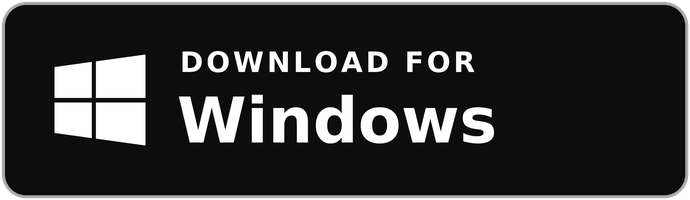

# Nitfeh (نتفة)

**Nitfeh** turns long lecture videos and recordings into small audio files, made by [Mudlej](https://mudlej.com).

An hour of lecture becomes about 5 MB: one voice channel, tuned for speech, playable in any current browser,
phone or media player. Nitfeh is a single file per system with a window and a command line, in English and
Arabic, and needs nothing installed.

## Screenshots

| Home | Lecture picked |
|:-:|:-:|
|  |  |
| **Converting** | **Done** |
|  |  |

## Download

Use the buttons above, or pick the file from the [latest release](https://github.com/mudlej/nitfeh/releases/latest):

| System | File | First start |
|---|---|---|
| Linux (x86-64, glibc 2.35 or newer) | [`nitfeh-linux-x86_64`](https://github.com/mudlej/nitfeh/releases/latest/download/nitfeh-linux-x86_64) | `chmod +x nitfeh-linux-x86_64` |
| Windows 10 and 11 (x86-64) | [`nitfeh-windows-x86_64.exe`](https://github.com/mudlej/nitfeh/releases/latest/download/nitfeh-windows-x86_64.exe) | SmartScreen: "More info", then "Run anyway" |
| macOS 11 or newer (Intel and Apple silicon) | [`Nitfeh-macos.dmg`](https://github.com/mudlej/nitfeh/releases/latest/download/Nitfeh-macos.dmg) | Open it and drag Nitfeh to Applications; the first time, right-click the app and choose Open |

The files are not signed with a paid certificate, which is why Windows and macOS ask the first time.

## Using it

Open Nitfeh, choose a lecture or a whole folder, pick a size and press Start. The button in the top corner
switches between English and Arabic.

| Size | Bitrate | An hour is about | |
|---|---|---|---|
| Standard | 12 kbps | 5.4 MB | Clear speech; the safe choice |
| Small | 10 kbps | 4.5 MB | A little rougher on noisy recordings |
| Smallest | 9 kbps | 4.1 MB | The lowest that still sounds clear |

The same from a terminal:

    nitfeh lecture.mp4                  # lecture.opus beside it
    nitfeh course/                      # every video in course/ into course-opus/
    nitfeh -r -p small course/ out/     # subfolders too, at the Small size
    nitfeh --help                       # every option

On macOS the command line is inside the app: `/Applications/Nitfeh.app/Contents/MacOS/nitfeh`.

## Good to know

- A file becomes `name.opus` beside it; a folder goes into a new folder next to it, `<folder>-opus`.
- Folders are read without their subfolders unless you ask (`-r`), and only videos unless you ask (`-a`).
- What is already converted is left alone, so a run that was stopped can simply be started again. To convert
  something again, Nitfeh asks whether to overwrite it or keep both (`--overwrite`, `--copy`).
- Nothing half-done is left behind: stopping or closing removes the file in progress.
- A file that cannot be converted is listed at the end, and the rest still finish.
- The audio is mono, 16 kHz Opus (`.opus`), encoded for speech. It is meant for lectures, not music.

## Building from source

    distrobox assemble create --file distrobox.ini && distrobox enter nitfeh
    just run        # build and open the window
    just check      # formatting, lints and tests
    just dist       # the Linux and Windows files, in work/dist

Creating the box installs every tool; the first recipe then builds static FFmpeg and libopus from pinned
sources. Without the box, run `./first_time_setup.sh` once instead. `just` lists every recipe, and `AGENTS.md`
has the notes for working on the code. Pushing a tag `v<version>` builds the three files in CI and publishes a
release.

## Licence

Made by [Mudlej](https://mudlej.com). GPL-3.0-or-later; see [LICENSE](LICENSE).

Nitfeh is built on FFmpeg (LGPL 2.1 or later, built without GPL or non-free parts; `tool/deps.sh` is the exact
build), libopus (BSD), Slint (under GPLv3) with its Material components (MIT), IBM Plex Sans Arabic (SIL Open
Font License) and Google's Material Symbols (Apache 2.0). The Linux, Windows and Apple logos on the download
buttons are from Font Awesome Free (CC BY 4.0) and belong to their owners.
